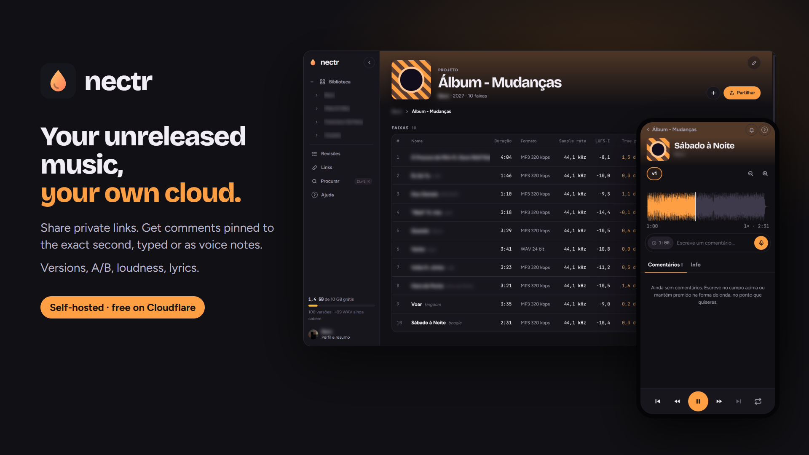
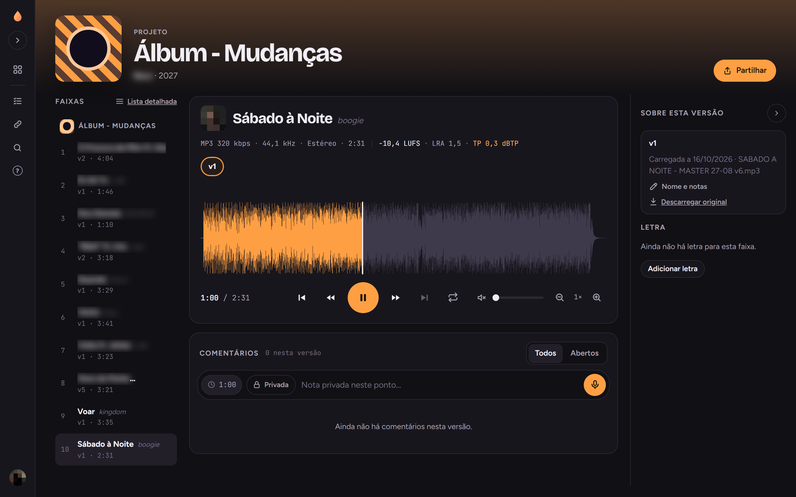
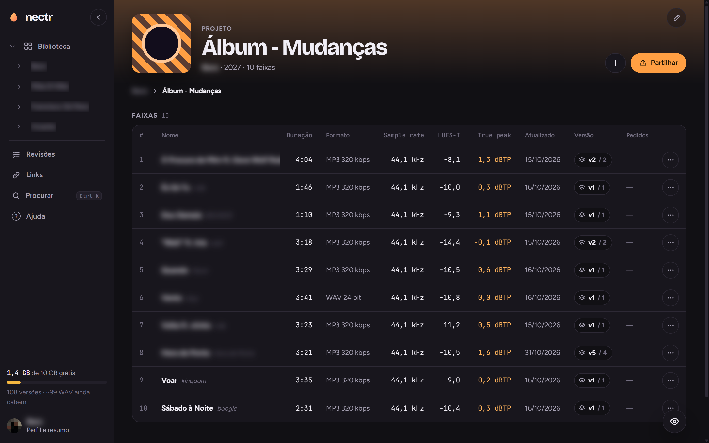
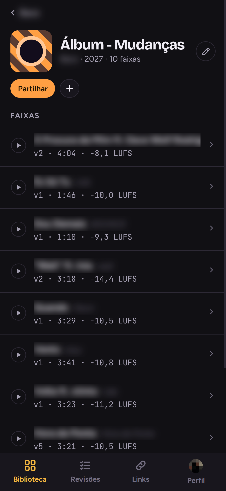
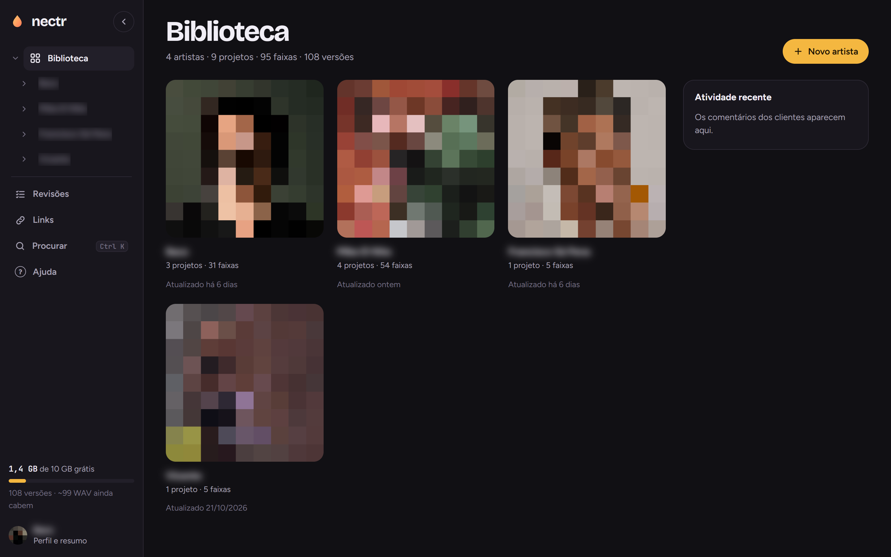
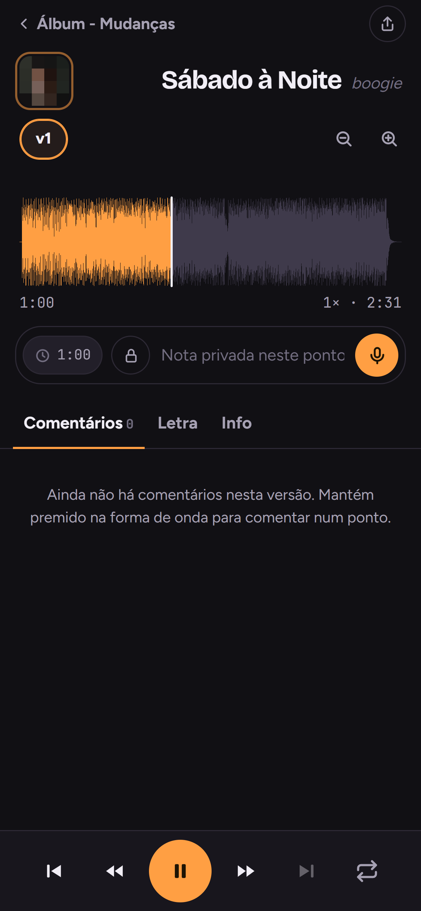
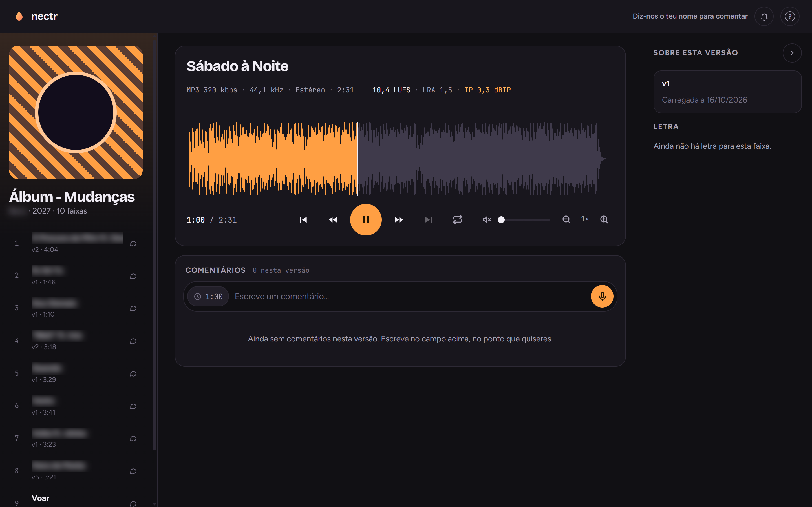
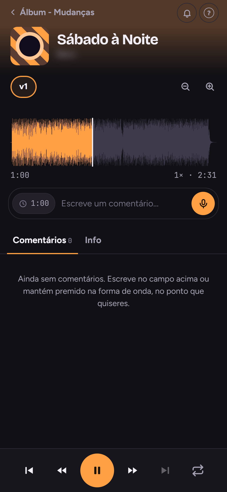

<div align="center">



**Share unreleased music privately and get feedback pinned to the exact second.**<br>
Your own cloud of tracks, versions and listening links, on Cloudflare's free plans.

<a href="LICENSE.md"></a>     <a href="https://ko-fi.com/bacoinz"></a>

[Run your own](#run-your-own) · [Make it yours](docs/prompts.md) · [Setup guide](docs/setup.md) · [Free-plan limits](docs/limites.md) · [🇵🇹 Português](README.pt-PT.md)



</div>

> [!NOTE]
> **The interface is in European Portuguese only.** You are free to translate it into any language: [docs/prompts.md](docs/prompts.md) has a ready-made prompt that does it with an AI coding assistant.

## Why nectr

Sending unreleased songs around usually means WeTransfer links that expire, Drive folders full of `final_v7_REAL.wav`, and feedback scattered across WhatsApp ("at around 1:20 the vocal…"). The services that fix this charge a monthly fee and keep your music on their servers.

nectr is the same idea, but **yours**:
- It runs on your own Cloudflare account, inside the free plans.
- There is no subscription and no third party holding your masters.
- The code is here to change.

The people you send music to (artists, labels, mixing engineers, friends) never need an account: they open a link, listen, and comment at the second they mean.

## Features

**Library**

- **Artists → projects → folders → tracks → versions.** A project can be an album/EP (cover, year, label, description), a work in progress, a live set or a plain folder.
- **Upload by dropping files anywhere:**
  - WAV (16/24 bit) and MP3, with a progress bar;
  - a whole folder from your computer becomes a project or a folder;
  - files go straight from the browser to storage.
- **Versions:**
  - drop a new mix on a track and it becomes the latest version;
  - drag one track onto another to merge them;
  - split a version back out into its own track;
  - "keep only the latest version" clears out the old ones.
- **Organise:**
  - 24 colours, icons, covers for projects and tracks, with a built-in image cropper;
  - drag to reorder;
  - a private *session name* (e.g. the Ableton Live Set name) that only you see;
  - search everything with Ctrl/⌘+K.

**Listening and reviewing**

- **Waveform player** with zoom up to 16×, loop, ±5 s, next track and keyboard shortcuts. It moves on to the next track when one ends.
- **Loudness on upload:** integrated LUFS, LRA and true peak (EBU R128 / ITU-R BS.1770). They are checked against ffmpeg's `ebur128` to within 0.04, and MP3s are decoded without clipping.
- **Instant A/B** between versions on desktop: the other versions stay loaded and follow the playhead (key **B** jumps back).
- **Synced lyrics:** paste or import `.lrc`, sync by tapping along, and see them karaoke-style.
- **Comments at a second or a range,** typed or as **voice notes** recorded in the browser. They show as markers on the waveform.
  - You can reply in public or keep private notes.
  - Requests are marked open or done, with the version that fixed them.
  - A **Reviews** page lists every open request in the library.

**Sharing links**

- **Share** an artist, a project, a folder or a single track.
- **Each link can have:**
  - a password;
  - an expiry date;
  - a download button;
  - lyrics;
  - comments;
  - a choice between "always the latest version", "all versions" or "only these versions".
- **Revoke** a link at any time. A dead link shows a neutral page that reveals nothing.
- **Guests:**
  - open a link and listen, on a page that works well on phones;
  - browse its folders, with the cover on the lock screen and the controls in the notification;
  - give a name once to comment (obvious spam names are refused).
- **Who came in:** each link lists who entered, when, and how many comments they left.
- **Re-shares, if you allow them:** a guest can pass on one track or folder as a listen-only link that dies with the original. You see who shared what with whom.

**Notifications and app**

- **Web Push** (free):
  - you get one for new comments, voice notes and re-shares;
  - guests get one for your replies and for new tracks or versions on their link.
- **Installable** on phone and desktop (PWA), with light and dark themes. A link can be installed on its own, under the project's name.
- **Storage meter** showing what the free plan has left. Anything you delete stays for 7 days so you can undo it, then is removed for good.

## Screenshots

<table>
  <tr>
    <td width="66%"></td>
    <td width="34%"></td>
  </tr>
  <tr>
    <td></td>
    <td></td>
  </tr>
  <tr>
    <td></td>
    <td></td>
  </tr>
</table>

<sub>Real library, with artists' photos and names and unreleased track titles hidden.</sub>

## What it costs

Nothing, as long as you stay within Cloudflare's free plans:

| Service | Free plan | What it means here |
|---|---|---|
| Workers | 100,000 requests/day | Far more than a musician and their clients use |
| R2 | 10 GB, no egress fees | ~115 five-minute 24-bit WAVs, or ~800 MP3s at 320 kbps |
| D1 | 5 GB | Years of comments |
| Access | 50 users | Only the owner logs in |

Turning on R2 asks for a card, but nothing is charged inside the free 10 GB. If you ever outgrow it, the Workers paid plan is 5 USD/month and R2 is ~0.015 USD per extra GB.

## Run your own

You need Node 22+ and, to put it online, a free Cloudflare account. It takes about 30 minutes.

```bash
git clone https://github.com/bacoinz/nectr && cd nectr
npm install
cp .dev.vars.example .dev.vars
npm run db:migrate:local
npm run dev
```

This gives you a full local copy at `http://localhost:5173`, with local storage and database. On localhost you are the owner without logging in. It is for trying the app out and for development, since guests cannot reach your computer.

**Putting it online:** follow [docs/setup.md](docs/setup.md). It is written in Portuguese, so you can ask an AI assistant to walk you through it in your language, or use prompt 1 in [docs/prompts.md](docs/prompts.md). In short:

1. Create the R2 bucket and the D1 database, then put your own IDs, email and Access values in `wrangler.jsonc`.
2. Create an R2 API token and add the secrets with `wrangler secret put`.
3. Run `npm run db:migrate:remote` and `npm run deploy`.
4. In Zero Trust, add an Access application on `/admin*` and `/api/admin*` (a one-time PIN by email is included).
5. Optional: run `node scripts/push-key.mjs` for notifications.

**On a Raspberry Pi, a NAS or your own server:** the code uses Cloudflare's D1, R2 and Access, so it needs a small adapter: SQLite, a folder on disk and your own login. The routes and the whole interface stay the same, and prompt 3 in [docs/prompts.md](docs/prompts.md) plans it with you. A free [Cloudflare Tunnel](https://developers.cloudflare.com/cloudflare-one/connections/connect-networks/) makes the box reachable without opening ports, and lets you keep Access for the login.

## Make it yours

The project is meant to be changed. It is plain TypeScript and Svelte, and the decisions are written down in [docs/plano.md](docs/plano.md), so an AI coding assistant (Claude Code, Cursor, Copilot…) finds its way around quickly. [docs/prompts.md](docs/prompts.md) has ready-to-paste prompts for these:

| Idea | What changes |
|---|---|
| 🌍 **Another language** | The interface strings and the server's messages |
| 🎬 **Video review** | A video player with frame-accurate timecodes instead of the waveform |
| 📷 **Photography** | Galleries, favourites, and comments on a point of the image instead of a second |
| 🎙️ **Podcasts / voice-over** | Takes as versions, notes from the producer |
| 🎨 **Design rounds** | Logo or cover rounds, with feedback per round |
| 🍓 **Raspberry Pi / own server** | SQLite, files on disk and your own login instead of D1, R2 and Access |

## How it works

| Part | What it uses |
|---|---|
| API and share pages | **Cloudflare Workers** (Hono) |
| Data | **D1** (SQLite) |
| Audio and images | **R2** |
| Owner login | **Cloudflare Access** |
| Interface | **Svelte 5 + Vite** |

- **Few dependencies:**
  - Hono;
  - `jose` (Access tokens);
  - `aws4fetch` (presigned uploads);
  - `mpg123-decoder` (exact MP3 peaks);
  - self-hosted fonts.
- Web Push encryption and VAPID are written on Web Crypto, with no library.
- Audio analysis (waveform and loudness) runs **in the browser**, so the server stays inside the free CPU limits. [docs/limites.md](docs/limites.md) shows where each free quota goes.
- **Security:**
  - only the owner's paths sit behind Access;
  - link passwords use PBKDF2, and attempts are rate-limited;
  - signed cookies;
  - a strict CSP;
  - audio is never cached by the service worker;
  - private fields (file names, session names, private notes) never leave the owner API, and tests check that.
- **Tests:** about 110, with Vitest on Cloudflare's Workers pool. They cover:
  - the API, links and permissions;
  - the clean-up job;
  - the loudness meter, against the EBU test signals;
  - Web Push encryption, against the RFC vectors;
  - lyrics parsing.

```
src/worker/   API, share pages, auth, cron clean-up, push (Cloudflare Worker)
src/web/      Interface (Svelte 5): admin/, guest/, comments/, audio/, lyrics/
src/shared/   Code used by both: audio validation, loudness, LRC, guest names
migrations/   D1 schema, in order
public/       Service worker, icons, manifest
docs/         Plan and decisions, setup, free-plan limits, manual checks, prompts
test/         Integration tests (Workers pool)
```

Useful commands: `npm run dev`, `npm test`, `npm run check`, `npm run build`, `npm run deploy`.

## License

[PolyForm Noncommercial 1.0.0](LICENSE.md). Free of charge, you can use it, change it and run it:
- for yourself, your band or your studio's own work;
- for a school or a non-profit.

Selling it, or selling access to it as a service, is not allowed. For anything commercial, ask the author.
