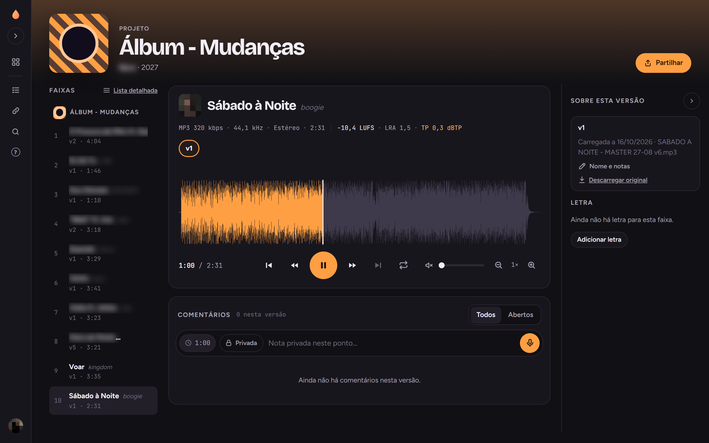

<div align="center">


# nectr

**Partilha música por lançar em privado e recebe comentários presos ao segundo certo.**

[Ter a tua](#ter-a-tua) · [Adaptar](docs/prompts.md) · [Setup](docs/setup.md) · [☕ Ko-fi](https://ko-fi.com/bacoinz) · [🇬🇧 English](README.md)



</div>

> [!NOTE]
> **A interface está só em português de Portugal.** És livre de a traduzir para qualquer língua: o [docs/prompts.md](docs/prompts.md) tem um prompt pronto para isso.

Um sítio privado para partilhar música por lançar e receber opinião sobre ela: a tua própria "cloud" de faixas, versões e links para ouvir, com comentários presos ao segundo certo. Corre na **tua** conta, nos planos gratuitos da Cloudflare. Não há assinatura e mais ninguém guarda a tua música.

> 🇬🇧 English version: [README.md](README.md). As funcionalidades, os custos e a estrutura estão descritos em detalhe lá. Aqui fica o resumo.

Foi feita para um músico (o dono) e para quem recebe a música: artistas, editoras, técnicos de mistura, amigos. Os convidados nunca precisam de conta.

## O que faz

- **Biblioteca**: artistas → projetos (álbum/EP, WIP, live, outra pasta) → pastas → faixas → versões. Largas WAV ou MP3 em qualquer lado, ou uma pasta inteira do computador.
- **Versões**: arrastas uma faixa para cima de outra para as juntar, e há a opção "manter apenas a última versão". No computador, o A/B entre versões é instantâneo.
- **Forma de onda** com zoom, repetir, faixa seguinte e atalhos de teclado.
- **Loudness** medido no upload (LUFS-I, LRA, true peak), validado contra o ffmpeg.
- **Letras** sincronizadas (.lrc), com editor por toques.
- **Organização**: capas, 24 cores, recorte de imagens, ordem, pesquisa (Ctrl+K), tema claro e escuro, e app instalável (PWA).
- **Links** para um artista, um projeto, uma pasta ou uma faixa. Cada link pode ter password, validade, download, letras, comentários e escolha das versões. Revogas quando quiseres.
- **Convidados**:
  - ouvem no telemóvel ou no computador, com o leitor nas notificações e no ecrã bloqueado;
  - comentam num segundo ou num intervalo, por escrito ou com **notas de voz**;
  - recebem avisos das tuas respostas e das músicas novas.
- **Para ti**:
  - página de revisões com os pedidos abertos e feitos;
  - quem entrou em cada link;
  - avisos no telemóvel;
  - partilhas feitas pelos convidados (só onde as ligares).

## Quanto custa

Nada, dentro dos planos gratuitos da Cloudflare: 100 000 pedidos por dia, 10 GB de áudio no R2 (cerca de 115 WAV de 5 minutos ou 800 MP3) e 5 GB de base de dados. Para ativar o R2 é preciso pôr um cartão, mas nada é cobrado dentro dos 10 GB. Mais detalhes em [docs/limites.md](docs/limites.md).

## Ter a tua

```bash
npm install
cp .dev.vars.example .dev.vars
npm run db:migrate:local
npm run dev
```

Isto abre uma cópia completa em `http://localhost:5173`, só no teu computador, e serve para experimentar. Para a pôr online, segue o [docs/setup.md](docs/setup.md).

Para correr fora da Cloudflare (servidor próprio, NAS, Raspberry Pi) é preciso uma pequena camada de adaptação: SQLite em vez do D1, uma pasta em vez do R2 e login próprio em vez do Access. O [docs/prompts.md](docs/prompts.md) tem um prompt pronto para isso.

## Adaptar às tuas necessidades

O projeto foi feito para ser mudado: código simples e as decisões todas escritas em [docs/plano.md](docs/plano.md). Com um assistente de IA (Claude Code, Cursor…) dá para o transformar, por exemplo:

- numa app de **revisão de vídeo**;
- numa app de entrega e escolha de **fotografias**;
- em **podcasts**;
- em rondas de **design**;
- numa versão em inglês.

Os prompts prontos a colar estão em [docs/prompts.md](docs/prompts.md).

## Licença

[PolyForm Noncommercial 1.0.0](LICENSE.md): podes usar, mudar e correr à vontade para ti, a tua banda, o teu estúdio, uma escola ou uma associação, de graça. Vender a app, ou vender o acesso a ela como serviço, não é permitido. Para uso comercial, fala com o autor.
